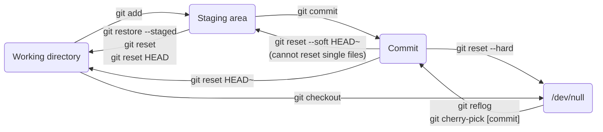
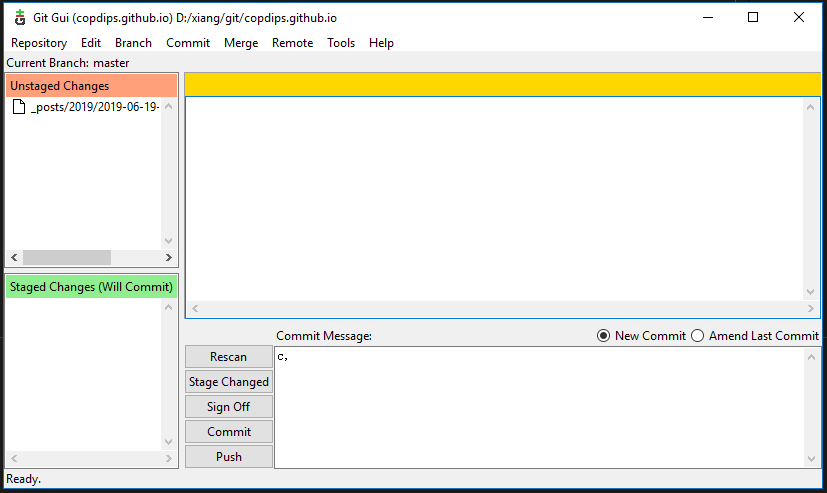

---
authors:
- copdips
categories:
- git
comments: true
date:
  created: 2019-06-19
  updated: 2026-08-25
---

# Git Cheat Sheet

This is not a complete Git cheat sheet for everyone, this is just a personal cheat sheet.

<!-- more -->

## Alias

User level alias

Edit `~/.gitconfig`

```bash
git config --global alias.amend commit --amend -C HEAD
git config --global alias.st status
git config --global alias.co checkout
git config --global alias.last log -1 HEAD
git config --global alias.ci commit
git config --global alias.unstage reset HEAD
git config --global alias.lga log --graph --decorate --oneline --all
git config --global alias.ll "log --graph --all --pretty=format:'%C(auto)%h%Creset %an: git config --global %s - %Creset %C(auto)%d%Creset %C(bold black)(%cr)%Creset %C(bold git config --global black)(%ci)%Creset' --no-abbrev-commit"
git config --global alias.sh show
git config --global alias.df diff
git config --global alias.br branch
git config --global alias.cm checkout main
git config --global alias.cd checkout dev
git config --global alias.rum pull --rebase upstream main
git config --global alias.rud pull --rebase upstream dev
git config --global alias.rom pull --rebase origin main
git config --global alias.rod pull --rebase origin dev
git config --global alias.sync-pr '!git fetch && git reset --hard @{u}'
```

## ~/.bashrc

```bash
alias gitpush='git ci -am "$gitmsg" ; git push origin $gitbranch'
alias gitamendpush='git add . ; git amend ; git push origin $gitbranch -f'
gitbrclean() {
    # delete branch $1 only if its content already landed in $2.
    # Compares just the files the branch touched: an unscoped
    # `git diff --quiet "$br" "$base"` reports a difference as soon as base
    # moves ahead, so it would never delete anything on a shared repo.
    # See "Deleting a branch after a squash merge" below.
    local br=$1 base=$2 files
    files=$(git diff --name-only "$base...$br")

    if [[ -z "$files" ]]; then
        echo "keep $br: introduces nothing over $base"
    elif git diff --quiet "$br" "$base" -- $files; then
        git br -D "$br"
    else
        echo "keep $br: content differs from $base, please confirm"
    fi
}

alias gitrebasemain='git cm ; git rom ; git fetch origin --prune ; if [[ -n "$gitbranch" && "$gitbranch" != "main" ]]; then gitbrclean "$gitbranch" main; fi'
alias gitrebasedev='git cd ; git rod ; git fetch origin --prune ; if [[ -n "$gitbranch" && "$gitbranch" != "dev" ]]; then gitbrclean "$gitbranch" dev; fi'
```

## Restore

### Restore a file to an old version

```bash
git restore --source [old_commit_hash] [file_name]
```

### Restore a deleted branch

```bash
git reflog
git branch [branch_name] [commit_hash_that_preceded_the_delete_commit]
```

## Undo



### Discard changes in working directory

```bash
# discard changes to a file in working directory
git checkout <filename or wildcard>

# discard changes to all files in working directory
git checkout .

# or
git checkout *
```

!!! note
    Untracked files cannot be discarded by checkout.

### Discard last commit (completely remove)

```bash
# better to show git log history before using --hard for rollback purpose.
git reset --hard HEAD~
```

!!! note
    We can recover the commit discarded by `--hard` with the `git cherry-pick [commit number]` if we displayed or saved it before. Whatever you can also use `git reflog` to get the commit number too.

### Unstage from staging area

[StackOverflow: How do I undo git add before commit?](https://stackoverflow.com/questions/348170/how-do-i-undo-git-add-before-commit)

```bash
# unstage a file from staging area
git reset <filename or wildcard>

# unstage all files from staging area
git reset
```

!!! note
    No more need to add `HEAD` like `git reset HEAD <file>` and `git reset HEAD` since git v1.8.2.

!!! warning
    Do not use `git rm --cached <filename>` to unstage, it works only for newly created file to remove them from the staging area. But if you specify a existing file, it will delete it from cache, even if it is not staged.

### Undo commit to working directory

[StackOverflow: How do I undo the most recent local commits in Git?](https://stackoverflow.com/questions/927358/how-do-i-undo-the-most-recent-local-commits-in-git)

You should readd the files if you want to commit them, as they're in the working directory now, they're unstaged too.

```bash
# Undo last commit to working directory
git reset HEAD~
# same as to
git reset HEAD~1

# Undo last 2 commits to working directory
git reset HEAD~2

# Undo till a special commit to working directory,
# the special commit and every commits before are still committed.
git reset <commit number>
```

!!! note
    `git reset HEAD` will do nothing, as the HEAD is already at the last commit.What?

!!! note
    `git reset HEAD~1 <file>` will create a delete file index in staging area. Normally we don't need this command.

### Undo commit to staging area

[StackOverflow: How do I undo the most recent local commits in Git?](https://stackoverflow.com/questions/927358/how-do-i-undo-the-most-recent-local-commits-in-git)

Add `--soft` to `git reset` to undo commit to staging area.

### Undo staging to working directory

```bash
# used after a git add
git restore --staged <file>
git reset
```

## Change commit timestamp

```bash
git rebase -i origin/main
# set 'e' to commits you want to change timestamp
# :x! to save and exit

# git will stop at the first commit marked with 'e'
git commit --amend --no-edit --date=now
# or to specify a date:
git commit --amend --no-edit --date="Wed Jun 19 14:00:00 2019 +0800"

# below will set the current timezone timestamps automatically
git commit --amend --no-edit --date="20240101 02:02:02"
# or to edit other fields:
git commit --amend
# :x! to save and exit

git rebase --continue
# git will stop at the next commit marked with 'e'
# continue with the same command above, till there's no more commit marked with 'e'
```

## Authentication

### With bearer token

```bash
# https://learn.microsoft.com/en-us/azure/devops/integrate/get-started/authentication/service-principal-managed-identity?view=azure-devops#q-can-i-use-a-service-principal-to-do-git-operations-like-clone-a-repo
git -c http.extraheader="AUTHORIZATION: bearer $ServicePrincipalAadAccessToken" clone https://dev.azure.com/{yourOrgName}/{yourProjectName}/_git/{yourRepoName}
```

## Branch

### Force local branch to the same with remote branch

```bash
git reset --hard upstream/master
or
git checkout -B master origin/master # sometimes this one might not work
```

### get last commit of another local branch

```bash
git cherry-pick another_local_branch
```

### get all commits of another local other_branch

```bash
get rebase another_local_branch
```

### get branches contains a commit

```bash
# local branches
git branch --contains <commit>

# remote branches
git branch -r --contains <commit>
```

### get branches pointing to a commit

```bash
# local branches
git branch --points-at <commit>

# remote branches
git branch -r --points-at <commit>

# get remote branches pointing to HEAD
# useful in Jenkins run if you want to know which remote branches
# are pointing to the current commit. (i.e. Jenkins pipeline branch)
# If multiple remote branches are pointing to the same commit,
# this command will return all of them,
# so won't work if you want to get only one remote branch.
git branch -r --points-at HEAD
```

### Deleting a branch after a squash merge

Squash merge writes a brand new commit on main, so the local branch shares no
hash ancestry with it. `git branch -d` checks ancestry, not content, but it
accepts the branch when it is merged into *either* HEAD *or* its upstream:

```bash
# remote branch still exists, upstream is reachable, -d succeeds
$ git branch -d feat/greet
warning: deleting branch 'feat/greet' that has been merged to
         'refs/remotes/origin/feat/greet', but not yet merged to HEAD
Deleted branch feat/greet (was dd5a6b1).

# repo deletes the head branch on merge and you pruned, upstream is gone, -d fails
$ git fetch --prune
$ git branch -d feat/greet
error: the branch 'feat/greet' is not fully merged.
If you are sure you want to delete it, run 'git branch -D feat/greet'
```

So `-d` only blocks once `delete_branch_on_merge` (or a manual remote delete)
plus a `--prune` has removed the upstream ref. That is exactly the state the
`gitrebasemain` alias creates, which is why it has to reach for `-D`.

#### Guarding -D with a content diff

`-D` skips the safety check, so guard it by comparing content. The obvious
comparison is wrong:

```bash
git diff --quiet feat/greet main   # exit 1, but not because the branch is unmerged
```

It reports a difference as soon as *main* moves ahead, which any other merged PR
does:

```text
$ git diff --stat feat/greet main
 src/api.py      | 11 +++++++++++
 src/auth.py     | 18 ++++++++++++++++++
 src/config.py   | 22 ++++++++++++++++++++++
 src/frontend.py | 11 +++++++++++
 src/retry.py    | 16 ++++++++++++++++
```

None of those files belong to `feat/greet`, whose own `src/greet.py` landed in
main earlier. On a shared repo this guard almost never passes, so the branch is
kept forever and the cleanup silently stops working.

Scope the comparison to the files the branch actually touched:

```bash
files=$(git diff --name-only main...feat/greet)   # three dots: branch vs merge-base
git diff --quiet feat/greet main -- $files        # exit 0, content fully landed
```

Beware the empty case: when `$files` is empty the `--` guard matches everything
again and the check silently inverts, so test for it separately. The
`gitbrclean` helper in the `~/.bashrc` section above covers the four cases:

| branch state | `$files` | scoped diff | outcome |
| --- | --- | --- | --- |
| squash-merged into base | non-empty | equal | deleted |
| carries unmerged work | non-empty | differs | kept |
| touches a file base also changed | non-empty | differs | kept |
| introduces nothing | empty | not run | kept |

## Show diff

### show content in staging area

```bash
git diff --cached
```

### show content in the last commit local repository

```bash
git show
git show HEAD
```

### show content in the second last commit in local repository

```bash
git show HEAD~
git show HEAD~1
```

## Disable host key checking

Sometimes during CICD, we need to use git to do something, if the remote repository is accessed by SSH, the first time when you use git (git clone for example), you need to accept the remote host key. This might be a problem for CICD as it cannot type `Y` for you as you do in an interactive session. To let git to disable the host key checking or precisely accept automatically the remote host key, you need to add the following line in git config:

```bash
> git config --global core.sshcommand 'ssh -i [YouPrivateKeyPath] -o UserKnownHostsFile=/dev/null -o StrictHostKeyChecking=no -F /dev/null'
```

You may need to use `git config --system` to set the config at system level.

## Proxy

Usually, in an enterprise environment, we need to use a proxy to connect to the Internet resources.
And from Powershell, we can ask Powershell to [inherit the IE proxy settings](https://copdips.com/2018/05/setting-up-powershell-gallery-and-nuget-gallery-for-powershell.html#configure-proxy-in-powershell).

With this proxy setting in Powershell, we should be able to use `git clone` to connect to the external <www.github.com> or to the internally hosted for example https://github.your_enterprise.local/

But trust me, some enterprises' proxy settings (often for those who use a [.pac](https://en.wikipedia.org/wiki/Proxy_auto-config) file) are so complicated that Powershell cannot use the proxy the same way as IE.

In such case, fortunately, git has its own proxy setting. I think the [official doc](https://git-scm.com/docs/git-config) doesn't explain very well how to set the proxy. But this [gist](https://gist.github.com/evantoli/f8c23a37eb3558ab8765) gives some good examples.

So, normally, you just need to set this config to ask git to use the `$internet_proxy` only for the url github.com, and all the other urls, git won't use the proxy.

```bash
git config --global http.https://github.com.proxy $internet_proxy
```

## GUI

GitForWindows ships with a GUI tool.

```bash
# start git gui tool
git gui
```



## Pull Requests with Rebase

Azure devops doc: [https://devblogs.microsoft.com/devops/pull-requests-with-rebase/](https://devblogs.microsoft.com/devops/pull-requests-with-rebase/)

### One fix commit per review comment

One commit per PR at creation; review fixes land as one commit per comment so
the reviewer can diff each fix directly.

```bash
git commit --fixup=<commit>       # adds a commit labeled fixup! <title>, the reviewer sees only this incremental diff
git rebase -i --autosquash <base> # folds each fixup into its target commit and rewrites history, needs force push after
```

`--fixup` is just a normal commit with a special message; nothing else changes.

`--autosquash` moves each fixup right after its target, folds its content in
and drops its message. Hashes are rewritten, so it needs a force push.

#### What the reviewer gets

A fixup is an ordinary commit, so the push is a fast-forward and each fix stays
addressable on its own:

```text
feat/greet                          reviewer clicks that commit and sees
------------------------------------------------------------------------
8f6645b  Add greet module           the whole feature
e33cf51  fixup! Add greet module    only the fix for review comment 1
dd5a6b1  fixup! Add greet module    only the fix for review comment 2
```

Compare with `git commit --amend` + force push: that replaces the tip, so the
"changes since your last review" link breaks and the reviewer re-reads
everything.

#### What lands in main

Two independent knobs decide the outcome, and only the first one lives in git:

1. whether `--autosquash` ran before the merge
2. how the forge builds the merge commit message

```text
no autosquash                    no autosquash                     autosquash
+ rebase merge                   + squash merge                    + either merge
--------------------------       ----------------------------      ---------------------------
main:                            main:                             main:
  dd5a6b1 fixup! Add greet         2677ce4 Add greet module (#1)      a73c729 Add greet module
  e33cf51 fixup! Add greet           * Add greet module
  8f6645b Add greet module           * fixup! Add greet module
                                     * fixup! Add greet module

3 commits, 2 are noise           1 commit, message polluted        1 commit, clean message
                                 (GitHub default setting)          (force push re-runs CI)
```

Full matrix, where the third column is the repo's `squash_merge_commit_message`
setting:

| autosquash | merge method | squash message | result in main |
| --- | --- | --- | --- |
| no | rebase | n/a | every `fixup!` commit lands verbatim |
| no | squash | `COMMIT_MESSAGES` | one commit, body lists every `fixup!` |
| no | squash | `PR_BODY` | one commit, title + PR description |
| no | squash | `BLANK` | one commit, title only |
| yes | rebase | n/a | one clean commit, force push needed |
| yes | squash | any | one clean commit, force push wasted |

#### Squash merge does not clean the message

A squash merge folds the tree into one commit, but the *message* is built from
whatever the repo is configured to use. GitHub's default is `COMMIT_MESSAGES`,
which concatenates every commit subject in the PR, so unsquashed fixups leak:

```text
Add greet module (#1)

* Add greet module

* fixup! Add greet module

* fixup! Add greet module
```

The tree is correct and only one commit is added, but the history now carries
review-round noise that means nothing to anyone reading main later.

#### Fix it once at the repo level

Set the message source instead of reaching for `--autosquash` on every PR:

```bash
# title = PR title (+ PR number), body = empty
gh api -X PATCH repos/OWNER/REPO \
  -f squash_merge_commit_title=PR_TITLE \
  -f squash_merge_commit_message=BLANK

# or keep the PR description as the body
gh api -X PATCH repos/OWNER/REPO \
  -f squash_merge_commit_title=PR_TITLE \
  -f squash_merge_commit_message=PR_BODY
```

With this set, a PR carrying unsquashed `fixup!` commits still squash-merges
into a clean `Add retry helper (#3)`. No autosquash, no force push, no wasted
CI run. Prefer `BLANK` when the repo also uses `gh stack`, whose generated PR
bodies contain an HTML banner that `PR_BODY` would copy into the commit message.

#### Autosquash rewrites hashes, not content

Worth knowing before paying for a force push: autosquash never changes the tip
tree, so the CI re-run it triggers tests byte-identical content.

```bash
git rev-parse HEAD^{tree}                                  # abb1f0ec44bf6feb...
GIT_SEQUENCE_EDITOR=true git rebase -i --autosquash main   # non-interactive
git rev-parse HEAD^{tree}                                  # abb1f0ec44bf6feb... identical
```

So `--autosquash` is only worth it on rebase-merge repos, where `fixup!`
commits would otherwise land in main verbatim. On squash-merge repos, configure
the message source instead.

## Stacked pull requests

[gh stack](https://github.com/github/gh-stack) turns a chain of branches into a
chain of PRs, each based on the branch below it, so a reviewer sees one layer
instead of the whole feature.

```bash
gh extension install github/gh-stack
git config rerere.enabled true         # remember conflict resolutions
git config remote.pushDefault origin   # required when the repo has several remotes
```

### Building a stack

```bash
gh stack init auth                  # create the stack, check out its first branch
git add . && git commit -m "Add auth middleware"
gh stack add api                    # next layer, branched from the current one
git add . && git commit -m "Add user API route"
gh stack add frontend
git add . && git commit -m "Add profile rendering"
gh stack submit --auto --open       # push every branch, open PRs ready for review
```

`--auto` skips the per-PR title prompt. Without `--open` the PRs are created as
drafts, and a draft cannot be merged.

The result is a chain where each PR targets the one below it:

```text
stack #7

  PR #6  frontend -> api     11 lines    top, merges last
  PR #5  api      -> auth    11 lines
  PR #4  auth     -> main    18 lines    bottom, merges first
```

Each reviewer sees only their own layer: PR #5 is 11 lines, not the 18 lines of
`auth` sitting underneath it.

### Merging a whole stack with one command

```bash
gh stack merge 7 --yes --squash     # stack number: every unmerged PR in the stack
gh stack merge 6 --yes --squash     # PR number: that PR plus everything below it
```

A bare number is resolved as a stack number first, and as a PR number only when
no stack matches. That order never turns ambiguous, because stack numbers are
drawn from the same sequence as issues and pull requests: a given number is
either a stack or a PR, never both.

```text
PR #1 .. #6    six pull requests
stack #7       a 3-layer stack, consuming number 7
issue #8       next number in the shared sequence
PR #9          single-branch stack, no stack number allocated
PR #10         its second layer
stack #11      stack object created once it held 2 PRs
```

A stack is registered on GitHub, and consumes a number, only once it holds at
least two PRs. A one-branch stack stays local and has no number to pass, so
`merge` and `checkout` take its PR number instead.

The operation is all or nothing. If any PR in the set cannot merge, none do.
Merging runs bottom to top and produces one commit per PR, not one commit for
the whole stack:

```text
$ gh stack merge 7 --yes --squash
Merging #4, #5, #6 into main via squash...
Merged #4, #5, #6 into main (08cfd25)

$ git log --oneline -3
08cfd25 Add profile rendering (#6)
7aa33e5 Add user API route (#5)
31f2bb1 Add auth middleware (#4)
```

Without a method flag the last-used method is reused. If the base branch uses a
merge queue the stack is queued instead, the queue picks the method, and any
flag passed is ignored with a warning.

### Things that bite

`gh stack sync --prune` prunes merged branches **locally only**. The remote
branches stay until deleted explicitly.

Generated PR bodies carry an HTML banner:

```text
<sub>Stack created with <a href="https://github.com/github/gh-stack">GitHub Stacks CLI</a> ...
```

With `squash_merge_commit_message=PR_BODY` that banner is copied verbatim into
the commit message on main. Use `BLANK` instead, or rewrite the body before
merging.

Most commands change behaviour depending on whether stdout is a TTY. In scripts,
pass the non-interactive flags: `view --json`, `submit --auto`, `merge --yes`,
`init <branch>`, `add <branch>`. `gh stack modify` is TUI-only, so restructure
with `unstack` then `init` instead.

## Moving Git repository content to another repository preserving history

```bash
# https://stackoverflow.com/a/55907198/5095636
# this keeps all commits history and git tags
$ git clone --bare https://github.com/exampleuser/old-repository.git
$ cd old-repository.git
$ git push --mirror https://github.com/exampleuser/new-repository.git
$ cd -
$ rm -rf old-repository.git
```

## Finding a string in the git log

```bash
git log -Spassword
```

## Finding where a file was added

- all occurrences (added, modified, deleted):

    ```bash
    git log -- file_name
    ```

- only added:

    there're also `A`, `M`, `D`, etc. <https://git-scm.com/docs/git-log#Documentation/git-log.txt---diff-filterACDMRTUXB82308203>

    ```bash
    git log --diff-filter=A -- file_name
    ```

## Forcing local master to the same as origin/main

<https://superuser.com/a/273199>

```bash
git checkout -B main origin/main
```

## Ignoring pre-commit hook

```bash
git commit --no-verify
```

## Change user.email for some repos

For all repos under `~/git` that match a certain pattern `repo_pattern` in the git url, change the user email to `new_email`.

```bash
new_email="my_new_email@copdips.com"
repo_pattern="company_name"
cd ~/git
all_folders=$(ls -d $PWD/*)
echo $all_folders | tr ' ' '\n' | while read -r folder ; \
    do \
        echo ====== $folder ; cd $folder ; \
        url=$(git remote get-url origin 2>/dev/null) ; \
        if [[ -n $url ]] ; then \
            if [[ $url =~ $repo_pattern ]] ; then \
                echo ~~~need to change email ; git config user.email $new_email ; \
            fi ; \
        fi ; \
        url= ; cd ~/git ; \
    done
```

## bash-git-prompt tweaks

[Some tweaks](../2024/2024-01-05-bash-git-prompt-tweaks.md) I made to [bash-git-prompt](https://github.com/magicmonty/bash-git-prompt). dynamic Python venv path, new var `gitmsg`, etc.

## My gitconfig

```bash
git config --global alias.amend "commit --amend -C HEAD"
git config --global alias.st "status"
git config --global alias.co "checkout"
git config --global alias.ci "commit"
git config --global alias.unstage "reset HEAD"
git config --global alias.lga "log --graph --decorate --oneline --all"
git config --global alias.ll "log --graph --all --pretty=format:'%C(auto)%h%Creset %an: %s - %Creset %C(auto)%d%Creset %C(bold black)(%cr)%Creset %C(bold black)(%ci)%Creset'"
git config --global alias.sh "show"
git config --global alias.df "diff"
git config --global alias.br "branch"
git config --global alias.cm "checkout main"
git config --global alias.cd "checkout dev"
git config --global alias.rum "pull --rebase upstream main"
git config --global alias.rud "pull --rebase upstream dev"
git config --global alias.rom "pull --rebase origin main"
git config --global alias.rod "pull --rebase origin dev"

# git doesn't have a default user level gitignore file
git config --global core.excludesfile ~/.gitignore

git config --global tag.sort "-v:refname"
git config --global init.defaultbranch main

git config --global user.name "Xiang ZHU"
git config --global user.email xiang.zhu@outlook.com

# for Git 2.34 or later, GPG sign commits with SSH key,
# use `git log --show-signature` to view signature status
git config --global gpg.format ssh
git config --global user.signingkey ~/.ssh/id_ed25519.pub

# auto add `-S` when commit
git config --global commit.gpgsign true
```
