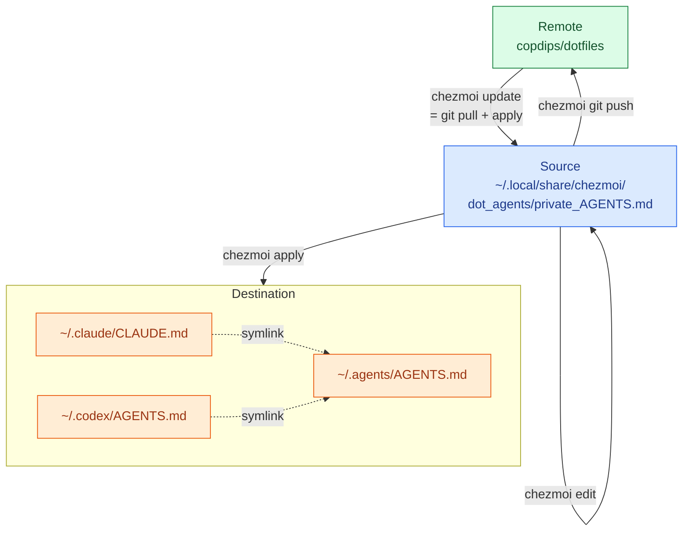

---
authors:
- copdips
categories:
- linux
comments: true
date:
  created: 2026-11-08
description: A 30-second workflow for editing, diffing, applying, and updating chezmoi-managed dotfiles.
---

# chezmoi Workflow: Edit, Diff, Apply

[chezmoi](https://www.chezmoi.io/) manages dotfiles from a single source directory, usually a git repository.
The same source can be applied on any machine: it renders templates, decrypts secrets, runs scripts, and writes the real files under `$HOME`.
For day-to-day work, the rule is simple: **edit the source, not the destination**.

```text
edit source -> diff -> apply -> push -> status
```

<!-- more -->

## The Flow

The global agent rules:



Who writes what:

- `chezmoi edit` changes the source: the editor opens the source file and saves it back; the loop never touches the destination.
- `chezmoi apply` writes the destination: it is the only arrow that does.
- A direct edit of the destination is drift: `chezmoi status` shows it, then keep it with `chezmoi add` or drop it with the next `chezmoi apply`.
- `chezmoi add` is only for that recovery, and only for non-template files; the normal flow never needs it.

Every path argument below is a destination path, and the example is `~/.agents/AGENTS.md`.

| # | Command | What it does | Direction |
|---|---|---|---|
| 1 | `chezmoi source-path ~/.agents/AGENTS.md` | Find the source file behind the destination | destination path -> source path |
| 2 | `chezmoi edit ~/.agents/AGENTS.md` | Take a destination path, but edit the source file (`~/.local/share/chezmoi/dot_agents/private_AGENTS.md`); the destination is not touched. With hardlinks enabled the editor filename matches the destination, but the inode is the source. `--apply` applies on exit, `--watch` applies on every save. With `git.autoCommit = true`, this step has already committed | editor -> source |
| 3 | `chezmoi diff ~/.agents/AGENTS.md` | Show what apply would change (`apply --dry-run` does not write) | source vs destination |
| 4 | `chezmoi apply ~/.agents/AGENTS.md` | Write the source to the destination; Claude Code and Codex then see the change through their symlinks | source -> destination |
| 5 | `chezmoi status` | Verify: show the drift left between the states | read-only comparison |
| 6 | `chezmoi update` | On another machine: `git pull --autostash --rebase` in the source repo (or `update.command`), then the same apply path | remote -> source -> destination |
| 7 | `chezmoi git push` | Publish the source commits. Runs git in the source repo from any directory, so no `chezmoi cd` is needed; `chezmoi cd` only opens a shell there, and plain `git push` in any other directory pushes that directory's repository. With `git.autoPush = false`, this step is yours to run | source -> remote |


!!! note "Symlink tracking"
    The two tool paths (Claude Code and Codex) are symlinks to the destination (`~/.agents/AGENTS.md`), so do not edit them directly:

    - ❌ `chezmoi edit ~/.claude/CLAUDE.md` edits the symlink source (the link target string), not the AGENTS.md content.
    - ✅ Use `chezmoi edit ~/.agents/AGENTS.md`.

    chezmoi also manages those two symlinks: each is a `symlink_` entry in the source (for example `dot_claude/symlink_CLAUDE.md`), created by `chezmoi apply`.

    Tracking them is not for daily edits: the link stores the target as a path, so changing the content behind `~/.agents/AGENTS.md` never touches the link. It covers two cases only:

    1. a new machine, where the links do not exist yet
    2. or a link that was deleted or replaced by a regular file, which `chezmoi status` reports and `chezmoi apply` restores.

## The Four States

| State | What it is | Example |
|---|---|---|
| Source state | What chezmoi edits and versions | `~/.local/share/chezmoi/dot_agents/private_AGENTS.md` |
| Target state | What the destination should look like, computed from the source | The same text as the source for `private_AGENTS.md`, which is not a template |
| Destination state | The real file on disk | `~/.agents/AGENTS.md` |
| Last written state | What chezmoi wrote to the destination last time; the drift baseline | chezmoi's persistent state |

These four names are chezmoi's own: `apply` "updates the destination to match the target state", and `diff` compares the two.

The target state is computed on every run and never stored. It differs from the source only when chezmoi transforms the content: templates (`.tmpl`, `{{ ... }}`) are rendered, so `.bashrc.tmpl` becomes `.bashrc` with the placeholders replaced; encrypted files are decrypted. A plain file like `private_AGENTS.md` has no transformation, so its target state is the source bytes.

It still matters even without templates: `chezmoi diff` and the second `chezmoi status` column compare the destination against the target state, not against the raw source.

`chezmoi status` prints two characters in front of each file. Both use the same letters, and a space means no difference:

| Char | 1st char: changed since chezmoi wrote it? | 2nd char: what `apply` will do |
|---|---|---|
| `M` | modified | modify the file |
| `A` | created | create the file |
| `D` | deleted | delete the file |
| space | no difference | no difference; the file is not listed |

Only the reference point differs: the first character compares the destination against what chezmoi last wrote, the second against the target. A destination that already matches the target therefore never shows up, even if something else touched it.

| Output | 1st char | 2nd char | Read it as |
|---|---|---|---|
| ` M ~/.bashrc` | space | `M` | you changed the source; apply writes the new version |
| `MM ~/.codex/config.toml` | `M` | `M` | the app rewrote it, so it no longer matches the target; apply would overwrite the app's change |
| `DA ~/.vimrc` | `D` | `A` | the file is gone; apply recreates it |

## Already Edited the Destination?

`chezmoi apply` prints:

```text
~/.agents/AGENTS.md has changed since chezmoi last wrote it?
```

That means the destination was modified outside chezmoi, most likely because the file was edited directly rather than through `chezmoi edit ~/.agents/AGENTS.md`, which edits the source.
Answering `y` overwrites it with the source, and the external edit is lost.

To keep the edit:

- Non-template file: promote the destination to the source with `chezmoi add <destination>`, then `chezmoi status`.
- Template file (`.tmpl`): do not run `chezmoi add`; it replaces the template with a plain file and drops the `{{ ... }}` logic. Put the change into the `.tmpl` by hand, or run `chezmoi merge <destination>` for a three-way merge. Then `chezmoi diff` and `chezmoi apply`.

## Pitfalls

**App-owned files drift again.**
`~/.claude/settings.json` and `~/.codex/config.toml` are rewritten when the app changes its own settings.
Adding a key to the template prevents an apply from dropping it, but the next app write creates new drift.
Run `chezmoi diff` before accepting an overwrite.

**`--force` skips the question.**
Use it only for a destination you have already reconciled.
