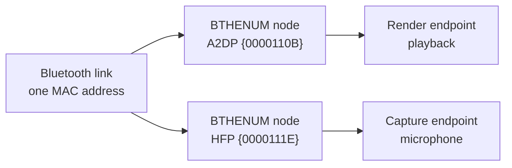

---
authors:
- copdips
categories:
- powershell
- debug
- windows
comments: true
date:
  created: 2026-11-12
description: On Windows 10/11, diagnose and repair a Bluetooth headset that Windows reports as connected while its playback or microphone endpoint is stuck, by reading the MMDevices registry and restarting the HFP device.
---

# Windows: Bluetooth Headset Connected but No Sound and No Microphone

On Windows 10/11, the headset shows **Connected**, but the music stays on the laptop speakers and no application lists the microphone. Re-pairing fixes it, until the next time.

A Bluetooth headset is two independent device stacks, and the "Connected" badge only covers the Bluetooth link. This post reads both stacks from the registry, and restarts the single PnP device that is stuck.

<!-- more -->

!!! tip "Quick access"
    [Usage](#usage) | [The Script](#the-script)

## Two Stacks Behind One Headset

- **A2DP** carries music and creates the **render** endpoint (playback).
- **HFP** (Hands-Free Profile, UUID `0000111E-0000-1000-8000-00805F9B34FB`) carries calls and creates the **capture** endpoint (microphone).

Each profile is its own `BTHENUM` device node with its own audio endpoint:



The link can be up while one endpoint is stuck. The Bluetooth page only sees the link, and the Sound page only lists usable endpoints, so a stuck microphone just disappears.

## Endpoint State in the Registry

Every endpoint lives under `HKLM\SOFTWARE\Microsoft\Windows\CurrentVersion\MMDevices\Audio`:

```text
HKLM\SOFTWARE\Microsoft\Windows\CurrentVersion\MMDevices\Audio\
+-- Render\{endpoint-guid}
|   +-- DeviceState
|   \-- Properties
\-- Capture\{endpoint-guid}
    +-- DeviceState
    \-- Properties
```

`DeviceState` uses the Core Audio `DEVICE_STATE_*` values, the same number `IMMDevice::GetState` returns:

| Value | Name | Meaning |
|---|---|---|
| `1` | `ACTIVE` | the endpoint exists and is usable |
| `2` | `DISABLED` | disabled in the Sound settings |
| `4` | `NOTPRESENT` | the endpoint is not present (the device node is missing) |
| `8` | `UNPLUGGED` | the endpoint exists but is not connected |

The `Properties` subkey links the endpoint back to its PnP devices:

| Property key | Holds | Example value |
|---|---|---|
| `{026e516e-b814-414b-83cd-856d6fef4822},2` | interface friendly name (the audio adapter) | `Bluetooth Audio Device` |
| `{a45c254e-df1c-4efd-8020-67d146a850e0},2` | device description | `Headphones` |
| `{b3f8fa53-0004-438e-9003-51a46e139bfc},39` | ancestor PnP instance paths | `{1}.BTHENUM\{0000111E-...}\6&...&38FBA04FE84A_C00000000` |
| `{b3f8fa53-0004-438e-9003-51a46e139bfc},2` | direct parent instance path | `{1}.BTHENUM\{0000110B-...}\6&...&38FBA04FE84A_C00000000` |
| `{b3f8fa53-0004-438e-9003-51a46e139bfc},6` | device name | `Baseus Bowie MC2 S` |
| `{b3f8fa53-0004-438e-9003-51a46e139bfc},26` | Hands-Free endpoint name | `Baseus Bowie MC2 S Hands-Free` |

These IDs are an observed layout, not a public API: stable on Windows 10/11, but not a contract.

## Diagnosis

After pairing, the `BTHENUM` nodes stay `OK` whether the headset is on or off, so `Get-PnpDevice -Status OK` cannot tell a live headset from a paired one that is switched off.

The endpoints are the real signal:

- a headset is connected when either endpoint is `ACTIVE`, which matches what Settings shows;
- the render and capture endpoints of one headset share the Bluetooth MAC in the instance path (`..._38FBA04FE84A_C00000000` or `DEV_38FBA04FE84A`);
- the capture side also gives the HFP node that the repair restarts.

| Render endpoint | Capture endpoint | Verdict | Action |
|---|---|---|---|
| `ACTIVE` | `ACTIVE` | healthy | nothing |
| `ACTIVE` | not `ACTIVE` | call channel stuck | rebuild |
| not `ACTIVE` | `ACTIVE` | playback stuck | rebuild |
| `ACTIVE` | missing | no capture endpoint | re-pair |
| not `ACTIVE` | missing | possibly LE Audio | check LE Audio |

No capture endpoint means the pairing or the profile enumeration is wrong; a restart will not create it.

## Repair

`Disable-PnpDevice` followed by `Enable-PnpDevice` tears the stack down and lets the driver recreate its endpoints. It is Device Manager's disable/enable, so it needs an elevated shell.

1. Restart the HFP node from the capture endpoint's ancestor chain, wait 10 s, re-read the endpoints.
2. If any target is still broken, restart the `MEDIA`-class device that owns the endpoints (by name, falling back to `Bluetooth.*Audio`), wait 12 s. That device is often shared, so other headsets can drop for a moment.

## Usage

```powershell
# Diagnose and repair every connected headset with a broken audio path
./fix-bluetooth-headset-audio.ps1

# Diagnosis only: no change, no admin rights
./fix-bluetooth-headset-audio.ps1 -DiagnoseOnly
```

The script asks before changing anything, and re-launches itself elevated through UAC when needed.

## The Script

<a class="md-button md-button--primary" href="/2026/scripts/fix-bluetooth-headset-audio.ps1" download="fix-bluetooth-headset-audio.ps1"><svg xmlns="http://www.w3.org/2000/svg" viewBox="0 0 24 24" width="18" height="18" aria-hidden="true" style="vertical-align:-3px;margin-right:6px"><path fill="currentColor" d="M5 20h14v-2H5v2zM19 9h-4V3H9v6H5l7 7 7-7z"/></svg>Download fix-bluetooth-headset-audio.ps1</a>

```powershell title="fix-bluetooth-headset-audio.ps1" linenums="1"
--8<-- "posts/2026/scripts/fix-bluetooth-headset-audio.ps1"
```

## Limits

- **Multipoint with a phone** - the phone owns the call channel, so Windows sees no usable capture endpoint. Disconnect the phone first.
- **No capture endpoint at all** - remove the pairing and pair the headset again.
- **LE Audio** - a headset paired over LE Audio may not expose an HFP endpoint, so the "no capture endpoint" verdict is expected.
- **Scope** - the A2DP/HFP nodes and the endpoint layout come from the Windows Bluetooth stack, not from the headset vendor, so nothing in the script is brand-specific. It was checked on Windows 11 build 26300 (Intel Bluetooth and audio stack) with Baseus, Huawei and Poly headsets; other audio drivers and LE Audio are untested.
