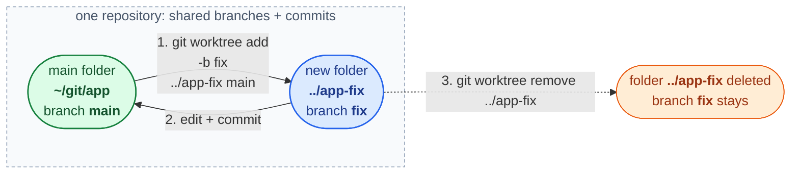

---
authors:
- copdips
categories:
- git
comments: true
date:
  created: 2026-11-15
description: "A git worktree is a second checkout of the same repository. Work on another branch in its own folder, commit, then delete the folder: the branch stays and the current checkout never moves."
---

# Git Worktree: Work on Another Branch Without Leaving the Current One

You need a change on another branch, but the current one is busy: edited files, a running test, a terminal in the right folder.
Stashing and switching loses all of that. A second clone copies the history and needs its own remotes.

A worktree is the middle ground: **one more folder, the same `.git`**.

```text
add -> edit -> commit -> remove    branch kept, your checkout untouched
```

<!-- more -->

## What It Is

One repository can have several working folders at once. Each folder has its own branch, its own files, its own index and HEAD. Branches, commits, tags and remotes are shared.



## The Commands

The template:

```text
git worktree add -b <new-branch> <worktree-folder> <base-branch>
```

The same line with real values, then the rest of the flow:

```bash
git worktree add -b fix ../app-fix main   # 1. new folder + new branch from main
cd ../app-fix                             # 2. work here as usual
git add -A && git commit -m "fix: x"      # 3. commits land on branch fix
git worktree remove ../app-fix            # 4. folder gone, branch fix stays
```

After that, the branch is still there: `git switch fix` in the main checkout, or push it and open a PR.

## Shared vs. Private

| Scope | What |
|-------|------|
| ✅ shared | branches, commits, tags, remotes |
| ❌ private | files, index, HEAD |

The shared items exist once for the whole repository; the private items exist once per worktree.
There is no sync step: a commit made in the worktree is already in the main repository, and the main checkout sees it immediately, without fetch or push.

## The Point

- The current checkout keeps its branch, its edits and its running tests.
- Another branch gets its own folder, so the two never fight over a file or `index.lock`.
- Several tasks can run side by side, one folder each. This is why agents like worktrees: the main checkout is never touched, and the folder is thrown away at the end.
- The folder is disposable; the branch is not.

## Two Rules

- **One worktree per branch.** `git worktree add` refuses a branch already checked out elsewhere: `fatal: 'fix' is already used by worktree at ...`. That includes the branch checked out in your main folder.
- **A dirty folder is not removed.** `git worktree remove` stops with `contains modified or untracked files`. Commit first, or pass `--force` to throw the edits away.

## If the Folder Is Already Gone

When a worktree folder is deleted by hand (a `/tmp` cleanup, for example), git keeps the record:

```bash
git worktree list      # the missing one is marked prunable
git worktree prune -v  # drop the records
```

Until then, `git branch` still marks that branch with `+`, and switching to it elsewhere fails.
`prune` only removes bookkeeping for folders that no longer exist: no branch, commit or tag is touched.
